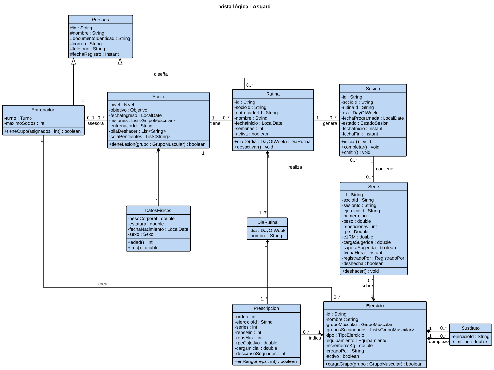
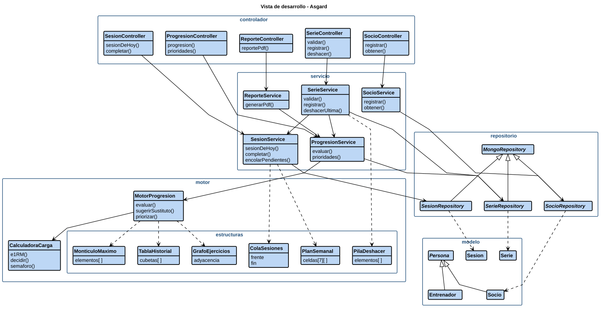

# 01. Descripción General

La arquitectura se presenta en cinco vistas, según la plantilla "Modelo de presentación de diseño". Todos los
diagramas están hechos con UML 2.5.1.

## 1.1 Vista de contexto

Muestra a Asgard como un único proceso, el círculo central, y las entidades externas con las que intercambia datos.

| Entidad externa | Envía a Asgard | Recibe de Asgard |
|---|---|---|
| Socio | Datos y series entrenadas | Carga sugerida y progreso |
| Entrenador | Ejercicios y rutinas | Reporte PDF y alertas |
| Reloj del sistema | Evento diario | — |
| MongoDB Atlas | Historial | Datos a guardar |

El reloj del sistema dispara la tarea diaria que manda a la cola las sesiones que el socio no realizó.

## 1.2 Vista funcional

Diagrama de componentes. El centro es el **Módulo de Progresión (motor)**, que tiene dos puertos:

- **Puerto de servicio:** por aquí el motor recibe las interfaces que le ofrecen los demás módulos.

  | Módulo | Interfaz que ofrece |
  |---|---|
  | Socios y Entrenadores | datos del socio y lesiones |
  | Catálogo de Ejercicios | ejercicios y sustitutos |
  | Rutinas | plan semanal |
  | Entrenamiento (sesiones y series) | historial de series |

- **Puerto de gestión:** ofrece *consultar progresión*. El socio la usa con una dependencia «use».

El motor también ofrece *carga sugerida y semáforo*, que usa el **Módulo de Reportes PDF**.

**Justificación:** cada módulo tiene una responsabilidad clara. El motor recibe todo por interfaces, así que puede
reemplazarse o extraerse sin tocar los demás módulos.

## 1.3 Vista lógica

Diagrama de clases del dominio. Son los documentos que se guardan en MongoDB.

- **Herencia:** `Persona` es abstracta y de ella heredan `Socio` y `Entrenador`.
- **Composición** (documentos embebidos):
  - `Socio` → `DatosFisicos` (1 a 1)
  - `Ejercicio` → `Sustituto` (1 a 0..*)
  - `Rutina` → `DiaRutina` (1 a 1..7)
  - `DiaRutina` → `Prescripcion` (1 a 1..*)
- **Asociaciones** (referencias por id):

  | Relación | Multiplicidad |
  |---|---|
  | Entrenador *asesora* Socio | `0..1` — `0..*` |
  | Entrenador *crea* Ejercicio | `1` — `0..*` |
  | Entrenador *diseña* Rutina | `1` — `0..*` |
  | Socio *tiene* Rutina (historial, con una activa) | `1` — `0..*` |
  | Socio *realiza* Sesion | `1` — `0..*` |
  | Rutina *genera* Sesion | `1` — `0..*` |
  | Sesion *contiene* Serie | `1` — `0..*` |
  | Sustituto, Prescripcion y Serie apuntan a Ejercicio | `0..*` — `1` |

- **Enumeraciones** (paquete `modelo.enums`):

  | Enumeración | Valores |
  |---|---|
  | `Nivel` | PRINCIPIANTE, INTERMEDIO, AVANZADO |
  | `Objetivo` | FUERZA, HIPERTROFIA, RESISTENCIA |
  | `GrupoMuscular` | PECHO, ESPALDA, HOMBROS, BICEPS, TRICEPS, CUADRICEPS, ISQUIOTIBIALES, GLUTEOS, PANTORRILLAS, CORE |
  | `TipoEjercicio` | COMPUESTO, AISLAMIENTO |
  | `Equipamiento` | BARRA, MANCUERNA, MAQUINA, POLEA, PESO_CORPORAL |
  | `Turno` | MANANA, TARDE, NOCHE |
  | `Sexo` | FEMENINO, MASCULINO |
  | `EstadoSesion` | PENDIENTE, EN_CURSO, COMPLETADA, OMITIDA |
  | `RegistradoPor` | SOCIO, ENTRENADOR |
  | `Semaforo` | VERDE, AMARILLO, ROJO |
  | `DecisionCarga` | SUBIR, MANTENER, BAJAR, DELOAD, SUSTITUIR |

  `Semaforo` y `DecisionCarga` los calcula el motor y no se guardan.

## 1.4 Vista de desarrollo

Organización del código del paquete `co.edu.ucc.asgard`, por capas:

| Capa | Clases |
|---|---|
| `controlador` | SocioController, SesionController, SerieController, ProgresionController, ReporteController |
| `servicio` | SocioService, SesionService, SerieService, ProgresionService, ReporteService |
| `motor` | MotorProgresion, CalculadoraCarga |
| `motor.estructuras` | PlanSemanal, TablaHistorial, GrafoEjercicios, MonticuloMaximo, PilaDeshacer, ColaSesiones |
| `repositorio` | MongoRepository, SocioRepository, SesionRepository, SerieRepository |
| `modelo` | Persona, Socio, Entrenador, Sesion, Serie |

- **Línea continua con flecha (asociación):** la clase guarda a la otra como atributo, inyectada por Spring.
- **Línea punteada con flecha (dependencia):** la clase usa a la otra dentro de un método.
- **Generalización:** los repositorios heredan de `MongoRepository`; `Socio` y `Entrenador` heredan de `Persona`.

El motor no depende de Spring Web ni de MongoDB (RNF-004).

## 1.5 Vista de despliegue

| Nodo «device» | Contenido |
|---|---|
| :Servidor de aplicaciones (Render) | :Contenedor Docker → :JVM 21 → artefacto `asgard.jar` |
| :Servidor de base de datos (MongoDB Atlas) | base de datos `asgard` |
| :Equipo del usuario | :Navegador web con Swagger UI, y :Postman con la colección de pruebas |

| Comunicación | Protocolo | Multiplicidad |
|---|---|---|
| Render — Navegador web / Postman | `https:443` (REST JSON) | `1` — `0..*` |
| Render — MongoDB Atlas | `mongodb+srv:27017` (TCP/IP con TLS) | `1` — `1` |
