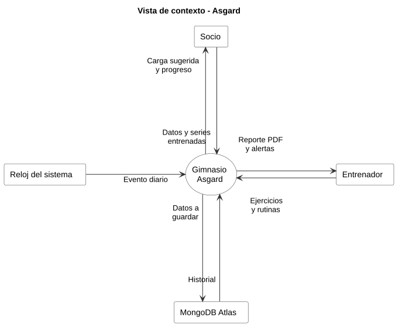
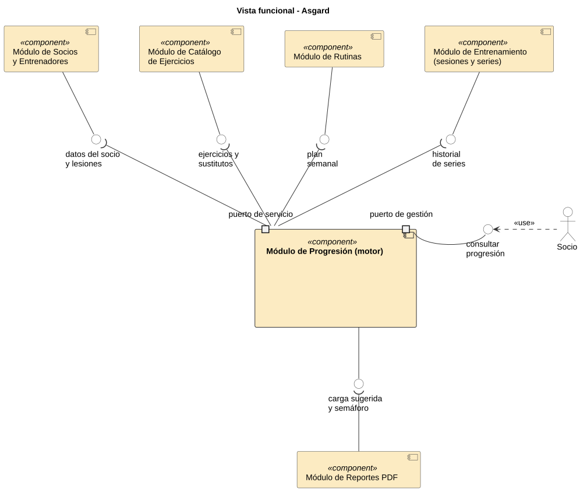
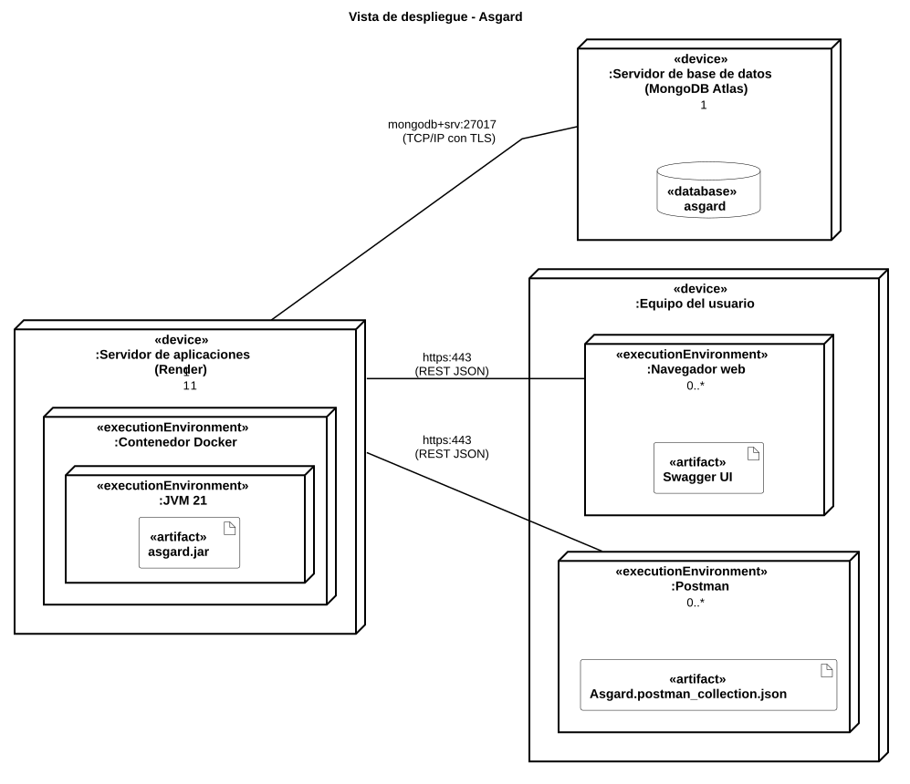

# 01. Descripción general

La arquitectura se documenta con cinco vistas: **contexto**, **funcional** (componentes), **lógica** (clases),
**desarrollo** (clases por capas) y **despliegue**. Todos los diagramas usan notación UML 2.5.1.

---

## 1.1 Vista de contexto

Asgard es un backend que atiende al socio y a su entrenador. Toda la interacción pasa por la API REST; la persistencia
recae en MongoDB Atlas y un planificador interno revisa cada día las sesiones que no se realizaron. El diagrama sigue
la notación de un DFD de nivel 0: el sistema es el proceso central y cada flecha es un flujo de datos con nombre.

### Actores y flujos

| Entidad externa | Tipo | Envía al sistema | Recibe del sistema |
|---|---|---|---|
| **Socio del gimnasio** | Usuario principal | Datos personales y físicos, lesiones, series entrenadas (peso, repeticiones y RPE), sesión completada, deshacer | Sesión del día, carga sugerida, semáforo de progreso, advertencias y prioridades |
| **Entrenador** | Usuario de apoyo | Ejercicios y sustitutos, rutinas semanales, series asistidas | Reporte PDF de progreso y alertas de estancamiento |
| **Reloj del sistema** | Actor temporal | Evento diario (00:00) | — |
| **MongoDB Atlas** | Sistema externo | Historial y configuración | Documentos a guardar |

---

## 1.2 Vista funcional

Diagrama de **componentes** (UML 2). El centro es el **Módulo de Progresión**, el motor del sistema. Los demás módulos
le ofrecen sus datos a través de interfaces, que el motor recibe por su **puerto de servicio**. Por su **puerto de
gestión** el socio consulta su progresión, y el Módulo de Reportes usa la carga sugerida y el semáforo para armar el
reporte del entrenador.

### Descripción del diagrama

| Componente | Interfaz | Responsabilidad |
|---|---|---|
| **Módulo de Socios y Entrenadores** | Ofrece `datos del socio y lesiones` | Registro del socio, datos físicos, lesiones y entrenador asignado (RF01). |
| **Módulo de Catálogo de Ejercicios** | Ofrece `ejercicios y sustitutos` | Catálogo de ejercicios y grafo de sustitutos (RF02). |
| **Módulo de Rutinas** | Ofrece `plan semanal` | Rutina semanal asignada por el entrenador (RF03). |
| **Módulo de Entrenamiento** | Ofrece `historial de series` | Sesión del día, registro de series, advertencias y deshacer (RF04–RF07). |
| **Módulo de Progresión (motor)** | Requiere las cuatro anteriores; ofrece `consultar progresión` y `carga sugerida y semáforo` | 1RM, carga sugerida, semáforo, estancamientos y prioridades (RF08–RF11). |
| **Módulo de Reportes PDF** | Requiere `carga sugerida y semáforo` | Historial y reporte PDF de progreso (RF12). |

### Puertos del motor

| Puerto | Qué hace |
|---|---|
| **Puerto de servicio** | Recibe las interfaces que ofrecen los módulos de socios, catálogo, rutinas y entrenamiento. |
| **Puerto de gestión** | Ofrece `consultar progresión`; el socio la usa con una dependencia `«use»`. |

### Justificación técnica

Los módulos agrupan las operaciones por responsabilidad: quién es el socio, qué ejercicios existen, qué rutina sigue,
qué entrenó y qué se reporta. El motor recibe todo por interfaces y no conoce cómo se guardan los datos, lo que cumple
el atributo de **escalabilidad modular** del caso: el motor de progresión se puede reemplazar o extraer sin tocar los
demás módulos.

---

## 1.3 Vista lógica

Modelo de dominio completo: diagrama de **clases** UML con atributos tipados, visibilidad, operaciones propias y
relaciones con multiplicidad.

### Modelo de dominio

- **Persona** (abstracta): datos comunes de identificación y contacto. De ella **heredan** `Socio` y `Entrenador`.
- **Socio** (colección `socios`): nivel, objetivo, fecha de ingreso y lesiones. **Embebe** sus `DatosFisicos`, por
  eso la relación es de **composición**. También guarda la `pilaDeshacer` con los ids de sus últimas series y la
  `colaPendientes` con las sesiones que no realizó.
- **Entrenador** (colección `entrenadores`): turno de trabajo y cupo máximo de socios.
- **Ejercicio** (colección `ejercicios`): grupo muscular, tipo, equipamiento e incremento de carga. **Embebe** sus
  `Sustituto`, cada uno con su grado de similitud.
- **Rutina** (colección `rutinas`): plan semanal del socio. **Embebe** sus `DiaRutina`, y cada día sus `Prescripcion`
  (series, rango de repeticiones, RPE objetivo y carga inicial).
- **Sesion** (colección `sesiones`): cada día de entrenamiento programado, con su estado.
- **Serie** (colección `series`): cada serie registrada, con peso, repeticiones, RPE, 1RM estimado, la carga sugerida
  en ese momento y si fue deshecha.

| Relación | Multiplicidad | Tipo |
|---|---|---|
| Persona – Socio / Entrenador | — | Generalización (herencia) |
| Socio – DatosFisicos | 1 – 1 | Composición (embebido) |
| Ejercicio – Sustituto | 1 – 0..* | Composición (embebido) |
| Rutina – DiaRutina | 1 – 1..7 | Composición (embebido) |
| DiaRutina – Prescripcion | 1 – 1..* | Composición (embebido) |
| Entrenador – Socio | 0..1 – 0..* | Asociación (referencia `entrenadorId`) |
| Entrenador – Ejercicio | 1 – 0..* | Asociación (referencia `creadoPor`) |
| Entrenador – Rutina | 1 – 0..* | Asociación (referencia `entrenadorId`) |
| Socio – Rutina | 1 – 0..* | Asociación (historial, con una rutina activa) |
| Socio – Sesion | 1 – 0..* | Asociación (referencia `socioId`) |
| Rutina – Sesion | 1 – 0..* | Asociación (referencia `rutinaId`) |
| Sesion – Serie | 1 – 0..* | Asociación (referencia `sesionId`) |
| Sustituto / Prescripcion / Serie – Ejercicio | 0..* – 1 | Asociación (referencia `ejercicioId`) |

### Enumeraciones

| Enum | Valores |
|---|---|
| `Nivel` | PRINCIPIANTE, INTERMEDIO, AVANZADO |
| `Objetivo` | FUERZA, HIPERTROFIA, RESISTENCIA |
| `GrupoMuscular` | PECHO, ESPALDA, HOMBROS, BICEPS, TRICEPS, CUADRICEPS, ISQUIOTIBIALES, GLUTEOS, PANTORRILLAS, CORE |
| `TipoEjercicio` | COMPUESTO, AISLAMIENTO |
| `Equipamiento` | BARRA, MANCUERNA, MAQUINA, POLEA, PESO_CORPORAL |
| `Turno` | MANANA, TARDE, NOCHE |
| `Sexo` | FEMENINO, MASCULINO |
| `EstadoSesion` | PENDIENTE, EN_CURSO, COMPLETADA, OMITIDA |
| `RegistradoPor` | SOCIO, ENTRENADOR |
| `Semaforo` | VERDE, AMARILLO, ROJO |
| `DecisionCarga` | SUBIR, MANTENER, BAJAR, DELOAD, SUSTITUIR |

### Semáforo de progreso de un ejercicio (RF09)

| 1RM estimado de las últimas 3 sesiones | Semáforo | Significado |
|---|---|---|
| Mejora o se mantiene | VERDE | Progresando: se sigue la doble progresión |
| No mejora en 3 sesiones | AMARILLO | Estancado: se sugiere una semana de descarga (deload) |
| Cae más de 5 % | ROJO | Retroceso o fatiga: se sugiere un ejercicio sustituto |

---

## 1.4 Vista de desarrollo

El código se organiza en **capas**: cada capa es un paquete de `co.edu.ucc.asgard`. Los controladores usan los
servicios; los servicios usan los repositorios, el motor y las estructuras de datos; los repositorios persisten el
modelo.

| Capa | Responsabilidad | Clases principales |
|---|---|---|
| **controlador** (`@RestController`) | Expone los endpoints REST, recibe y devuelve DTOs. | `SocioController`, `SesionController`, `SerieController`, `ProgresionController`, `ReporteController` |
| **servicio** (`@Service`) | Lógica de negocio y planificador de sesiones. | `SocioService`, `SesionService`, `SerieService`, `ProgresionService`, `ReporteService` |
| **motor** | Motor de progresión; no depende de la base de datos. | `MotorProgresion`, `CalculadoraCarga` |
| **motor.estructuras** | Estructuras de datos del caso de estudio. | `PlanSemanal`, `TablaHistorial`, `GrafoEjercicios`, `MonticuloMaximo`, `PilaDeshacer`, `ColaSesiones` |
| **repositorio** | Acceso a datos con `MongoRepository<T, ID>`. | `SocioRepository`, `SesionRepository`, `SerieRepository` |
| **modelo** (`@Document`) | Documentos de MongoDB y enumeraciones. | `Persona`, `Socio`, `Entrenador`, `Sesion`, `Serie` y sus embebidos |

### Relaciones del diagrama

| Relación | Notación | Significado | Ejemplo |
|---|---|---|---|
| **Asociación** | Línea continua con flecha | La clase guarda a la otra como atributo, inyectada por Spring. | `SerieController` → `SerieService` |
| **Dependencia** | Línea punteada con flecha | La clase usa a la otra dentro de un método. | `SerieService` usa `PilaDeshacer` |
| **Generalización** | Línea con triángulo | Herencia de clase o de interfaz. | `SocioRepository` hereda de `MongoRepository`; `Socio` hereda de `Persona` |

---

## 1.5 Vista de despliegue

Despliegue en tres nodos: el equipo del usuario desde donde se consume la API, el servidor de aplicaciones en Render que
corre el contenedor Docker con el *fat-jar* de Spring Boot, y el servidor de base de datos en MongoDB Atlas.

### Descripción de los nodos

| Nodo | Estereotipo | Entorno de ejecución | Artefacto |
|---|---|---|---|
| Equipo del usuario | `«device»` | Navegador web / Postman | Swagger UI, colección de Postman |
| Servidor de aplicaciones (Render) | `«device»` | Contenedor Docker → JVM 21 | `asgard.jar` (Spring Boot) |
| Servidor de base de datos (MongoDB Atlas) | `«device»` | Motor MongoDB | Base de datos `asgard` |

### Protocolos de comunicación

| Origen y destino | Protocolo | Multiplicidad |
|---|---|---|
| Equipo del usuario → servidor de aplicaciones | HTTPS / REST (JSON), puerto 443 | 0..* – 1 |
| Servidor de aplicaciones → base de datos | TCP/IP (`mongodb+srv`, TLS), puerto 27017 | 1 – 1 |
