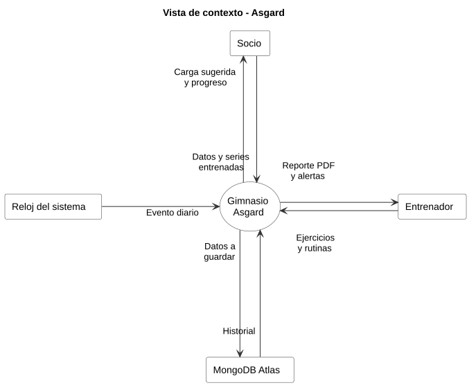

# 1.1 Vista de contexto

Muestra a Asgard como un único proceso, el círculo central, y las entidades externas con las que intercambia datos.

| Entidad externa | Envía a Asgard | Recibe de Asgard |
|---|---|---|
| Socio | Datos y series entrenadas | Carga sugerida y progreso |
| Entrenador | Ejercicios y rutinas | Reporte PDF y alertas |
| Reloj del sistema | Evento diario | — |
| MongoDB Atlas | Historial | Datos a guardar |

El reloj del sistema dispara la tarea diaria que manda a la cola las sesiones que el socio no realizó.

---

[01. Descripción General](01.-Descripción-General) · [1.2 Vista funcional](1.2-Vista-funcional) →
