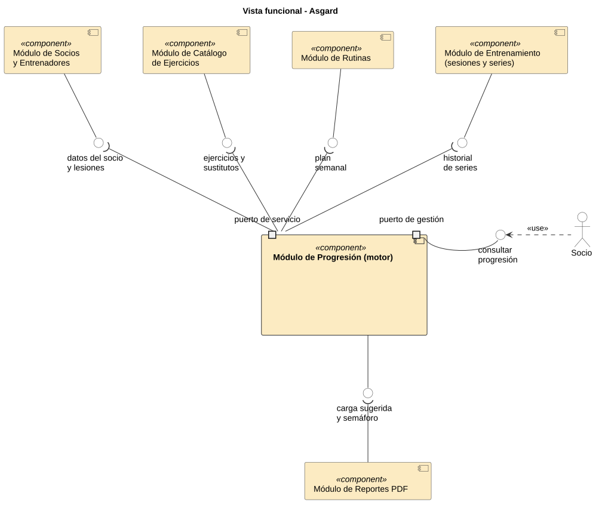

# 1.2 Vista funcional

Diagrama de componentes. El centro es el **Módulo de Progresión (motor)**, que tiene dos puertos:

- **Puerto de servicio:** por aquí el motor recibe las interfaces que le ofrecen los demás módulos.

  | Módulo | Interfaz que ofrece |
  |---|---|
  | Socios y Entrenadores | datos del socio y lesiones |
  | Catálogo de Ejercicios | ejercicios y sustitutos |
  | Rutinas | plan semanal |
  | Entrenamiento (sesiones y series) | historial de series |

- **Puerto de gestión:** ofrece *consultar progresión*. El socio la usa con una dependencia «use».

El motor también ofrece *carga sugerida y semáforo*, que usa el **Módulo de Reportes PDF**.

**Justificación:** cada módulo tiene una responsabilidad clara. El motor recibe todo por interfaces, así que puede
reemplazarse o extraerse sin tocar los demás módulos.

---

← [1.1 Vista de contexto](1.1-Vista-de-contexto) · [01. Descripción General](01.-Descripción-General) · [1.3 Vista lógica](1.3-Vista-lógica) →
