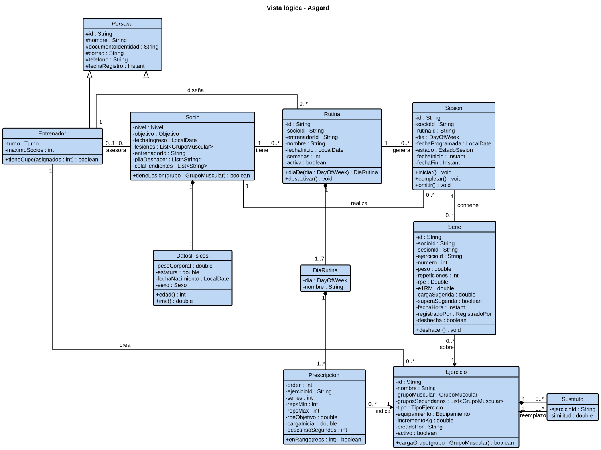

# 1.3 Vista lógica

Diagrama de clases del dominio. Son los documentos que se guardan en MongoDB.

- **Herencia:** `Persona` es abstracta y de ella heredan `Socio` y `Entrenador`.
- **Composición** (documentos embebidos):
  - `Socio` → `DatosFisicos` (1 a 1)
  - `Ejercicio` → `Sustituto` (1 a 0..*)
  - `Rutina` → `DiaRutina` (1 a 1..7)
  - `DiaRutina` → `Prescripcion` (1 a 1..*)
- **Asociaciones** (referencias por id):

  | Relación | Multiplicidad |
  |---|---|
  | Entrenador *asesora* Socio | `0..1` — `0..*` |
  | Entrenador *crea* Ejercicio | `1` — `0..*` |
  | Entrenador *diseña* Rutina | `1` — `0..*` |
  | Socio *tiene* Rutina (historial, con una activa) | `1` — `0..*` |
  | Socio *realiza* Sesion | `1` — `0..*` |
  | Rutina *genera* Sesion | `1` — `0..*` |
  | Sesion *contiene* Serie | `1` — `0..*` |
  | Sustituto, Prescripcion y Serie apuntan a Ejercicio | `0..*` — `1` |

- **Enumeraciones** (paquete `modelo.enums`):

  | Enumeración | Valores |
  |---|---|
  | `Nivel` | PRINCIPIANTE, INTERMEDIO, AVANZADO |
  | `Objetivo` | FUERZA, HIPERTROFIA, RESISTENCIA |
  | `GrupoMuscular` | PECHO, ESPALDA, HOMBROS, BICEPS, TRICEPS, CUADRICEPS, ISQUIOTIBIALES, GLUTEOS, PANTORRILLAS, CORE |
  | `TipoEjercicio` | COMPUESTO, AISLAMIENTO |
  | `Equipamiento` | BARRA, MANCUERNA, MAQUINA, POLEA, PESO_CORPORAL |
  | `Turno` | MANANA, TARDE, NOCHE |
  | `Sexo` | FEMENINO, MASCULINO |
  | `EstadoSesion` | PENDIENTE, EN_CURSO, COMPLETADA, OMITIDA |
  | `RegistradoPor` | SOCIO, ENTRENADOR |
  | `Semaforo` | VERDE, AMARILLO, ROJO |
  | `DecisionCarga` | SUBIR, MANTENER, BAJAR, DELOAD, SUSTITUIR |

  `Semaforo` y `DecisionCarga` los calcula el motor y no se guardan.

---

← [1.2 Vista funcional](1.2-Vista-funcional) · [01. Descripción General](01.-Descripción-General) · [1.4 Vista de desarrollo](1.4-Vista-de-desarrollo) →
