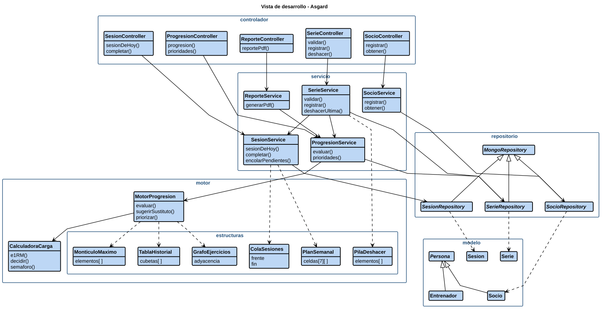

# 1.4 Vista de desarrollo

Organización del código del paquete `co.edu.ucc.asgard`, por capas:

| Capa | Clases |
|---|---|
| `controlador` | SocioController, SesionController, SerieController, ProgresionController, ReporteController |
| `servicio` | SocioService, SesionService, SerieService, ProgresionService, ReporteService |
| `motor` | MotorProgresion, CalculadoraCarga |
| `motor.estructuras` | PlanSemanal, TablaHistorial, GrafoEjercicios, MonticuloMaximo, PilaDeshacer, ColaSesiones |
| `repositorio` | MongoRepository, SocioRepository, SesionRepository, SerieRepository |
| `modelo` | Persona, Socio, Entrenador, Sesion, Serie |

- **Línea continua con flecha (asociación):** la clase guarda a la otra como atributo, inyectada por Spring.
- **Línea punteada con flecha (dependencia):** la clase usa a la otra dentro de un método.
- **Generalización:** los repositorios heredan de `MongoRepository`; `Socio` y `Entrenador` heredan de `Persona`.

El motor no depende de Spring Web ni de MongoDB (RNF-004).

---

← [1.3 Vista lógica](1.3-Vista-lógica) · [01. Descripción General](01.-Descripción-General) · [1.5 Vista de despliegue](1.5-Vista-de-despliegue) →
