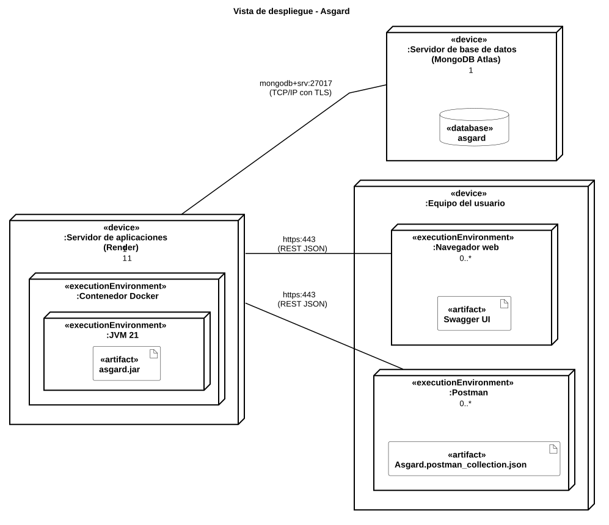

# 1.5 Vista de despliegue

| Nodo «device» | Contenido |
|---|---|
| :Servidor de aplicaciones (Render) | :Contenedor Docker → :JVM 21 → artefacto `asgard.jar` |
| :Servidor de base de datos (MongoDB Atlas) | base de datos `asgard` |
| :Equipo del usuario | :Navegador web con Swagger UI, y :Postman con la colección de pruebas |

| Comunicación | Protocolo | Multiplicidad |
|---|---|---|
| Render — Navegador web / Postman | `https:443` (REST JSON) | `1` — `0..*` |
| Render — MongoDB Atlas | `mongodb+srv:27017` (TCP/IP con TLS) | `1` — `1` |

---

← [1.4 Vista de desarrollo](1.4-Vista-de-desarrollo) · [01. Descripción General](01.-Descripción-General)
