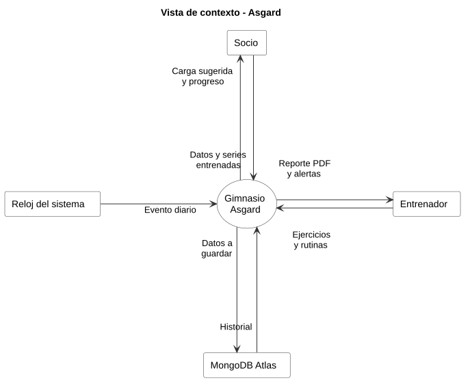
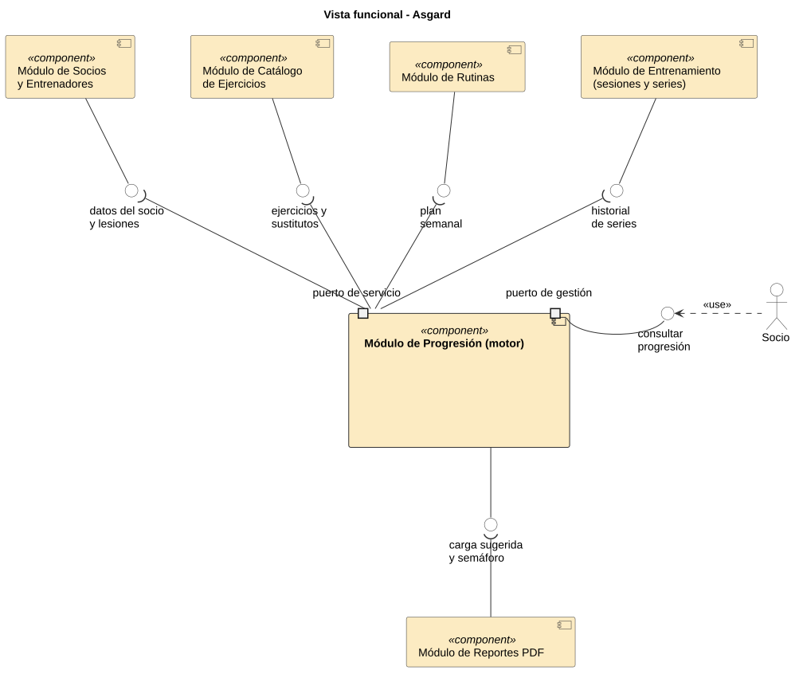
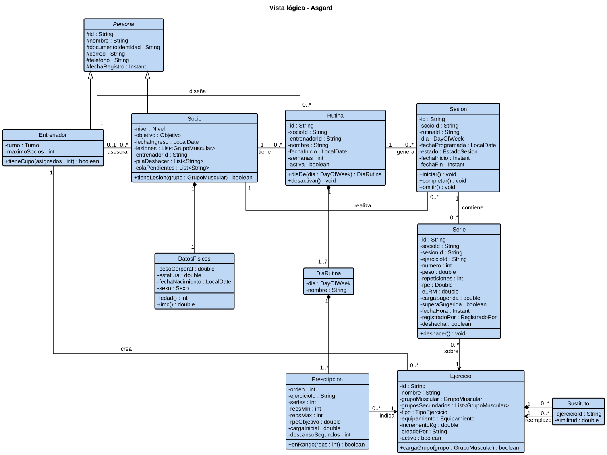
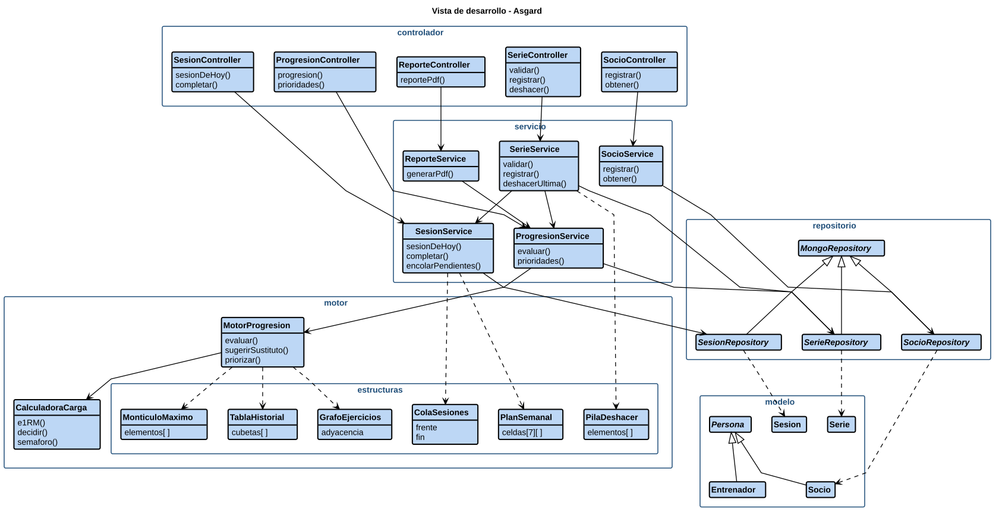
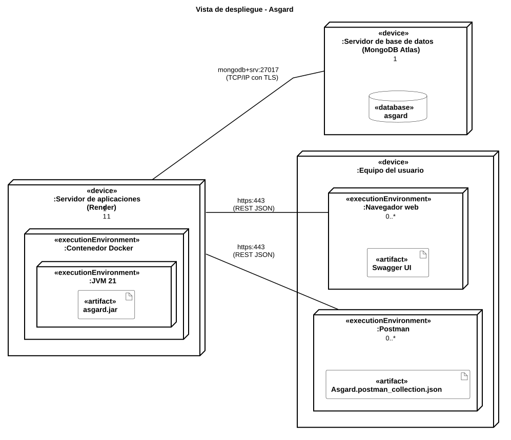

# Diagramas de Asgard

La arquitectura de Asgard se presenta en cinco vistas, según la plantilla "Modelo de presentación de diseño":
contexto, funcional, lógica, desarrollo y despliegue.

| Vista | Diagrama | Archivo |
|---|---|---|
| Contexto | Diagrama de contexto (DFD nivel 0) | `vista-de-contexto-asgard.svg` |
| Funcional | Diagrama de componentes | `vista-funcional-asgard.svg` |
| Lógica | Diagrama de clases del dominio | `vista-logica-asgard.svg` |
| Desarrollo | Diagrama de clases de implementación por capas | `vista-de-desarrollo-asgard.svg` |
| Despliegue | Diagrama de despliegue | `vista-de-despliegue-asgard.svg` |

---

## 1. Vista de contexto

Muestra a Asgard como un único proceso, el círculo central, y las entidades externas con las que intercambia datos.

| Entidad externa | Envía a Asgard | Recibe de Asgard |
|---|---|---|
| Socio | Datos y series entrenadas | Carga sugerida y progreso |
| Entrenador | Ejercicios y rutinas | Reporte PDF y alertas |
| Reloj del sistema | Evento diario | — |
| MongoDB Atlas | Historial | Datos a guardar |

El reloj del sistema dispara la tarea diaria que manda a la cola las sesiones que el socio no realizó.

---

## 2. Vista funcional

Muestra los módulos del sistema y las interfaces que ofrecen y requieren. El centro es el **Módulo de Progresión
(motor)**, que tiene dos puertos:

- **Puerto de servicio:** por aquí el motor recibe las interfaces que le ofrecen los demás módulos.

  | Módulo | Interfaz que ofrece |
  |---|---|
  | Socios y Entrenadores | datos del socio y lesiones |
  | Catálogo de Ejercicios | ejercicios y sustitutos |
  | Rutinas | plan semanal |
  | Entrenamiento (sesiones y series) | historial de series |

- **Puerto de gestión:** ofrece *consultar progresión*. El socio la usa con una dependencia «use».

El motor también ofrece *carga sugerida y semáforo*, que usa el **Módulo de Reportes PDF** para el reporte del
entrenador.

---

## 3. Vista lógica

Muestra las clases del dominio, que son los documentos que se guardan en MongoDB.

- **Herencia:** `Persona` es abstracta y de ella heredan `Socio` y `Entrenador`.
- **Composición** (rombo negro), para los documentos embebidos:
  - `Socio` → `DatosFisicos`
  - `Ejercicio` → `Sustituto`
  - `Rutina` → `DiaRutina`
  - `DiaRutina` → `Prescripcion`
- **Asociaciones**, para las referencias por id, con nombre y multiplicidad:

  | Relación | Multiplicidad |
  |---|---|
  | Entrenador *asesora* Socio | `0..1` — `0..*` |
  | Entrenador *crea* Ejercicio | `1` — `0..*` |
  | Entrenador *diseña* Rutina | `1` — `0..*` |
  | Socio *tiene* Rutina (historial, con una activa) | `1` — `0..*` |
  | Socio *realiza* Sesion | `1` — `0..*` |
  | Rutina *genera* Sesion | `1` — `0..*` |
  | Sesion *contiene* Serie | `1` — `0..*` |
  | Sustituto, Prescripcion y Serie apuntan a Ejercicio | `0..*` — `1` |

- **Visibilidad:** `#` protegido (atributos de `Persona`), `-` privado (atributos) y `+` público (métodos).
- **Tipos enumerados:** `Nivel`, `Objetivo`, `GrupoMuscular`, `TipoEjercicio`, `Equipamiento`, `Turno`, `Sexo`,
  `EstadoSesion` y `RegistradoPor`. Están en el paquete `modelo.enums`.

---

## 4. Vista de desarrollo

Muestra cómo está organizado el código del paquete `co.edu.ucc.asgard`: las capas y las clases principales de cada una.

| Capa | Clases |
|---|---|
| `controlador` | SocioController, SesionController, SerieController, ProgresionController, ReporteController |
| `servicio` | SocioService, SesionService, SerieService, ProgresionService, ReporteService |
| `motor` | MotorProgresion, CalculadoraCarga |
| `motor.estructuras` | PlanSemanal (matriz 2D), TablaHistorial (tabla hash), GrafoEjercicios (grafo), MonticuloMaximo (Max-Heap), PilaDeshacer (pila LIFO), ColaSesiones (cola FIFO) |
| `repositorio` | MongoRepository, SocioRepository, SesionRepository, SerieRepository |
| `modelo` | Persona, Socio, Entrenador, Sesion, Serie |

Las relaciones se leen así:
- **Línea continua con flecha (asociación):** la clase guarda a la otra como atributo, inyectada por Spring.
  Por ejemplo, `SerieController` → `SerieService`.
- **Línea punteada con flecha (dependencia):** la clase usa a la otra dentro de un método.
  Por ejemplo, `SerieService` usa `PilaDeshacer` para deshacer la última serie.
- **Generalización (triángulo):** los repositorios son interfaces que heredan de `MongoRepository`.
  `Socio` y `Entrenador` heredan de `Persona`.

El motor no depende de Spring Web ni de MongoDB (RNF-004).

---

## 5. Vista de despliegue

Muestra dónde se ejecuta cada parte del sistema.

| Nodo «device» | Contenido |
|---|---|
| :Servidor de aplicaciones (Render) | :Contenedor Docker → :JVM 21 → artefacto `asgard.jar` |
| :Servidor de base de datos (MongoDB Atlas) | base de datos `asgard` |
| :Equipo del usuario | :Navegador web con Swagger UI, y :Postman con la colección de pruebas |

| Comunicación | Protocolo | Multiplicidad |
|---|---|---|
| Render — Navegador web / Postman | `https:443` (REST JSON) | `1` — `0..*` |
| Render — MongoDB Atlas | `mongodb+srv:27017` (TCP/IP con TLS) | `1` — `1` |
